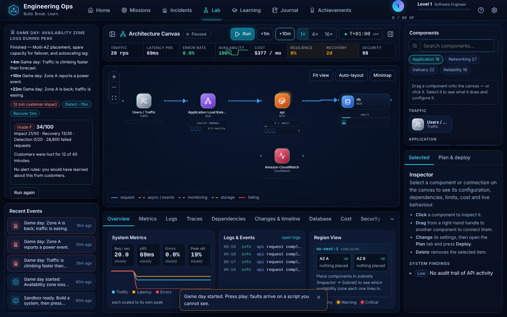

# Game days

A game day is a scripted sequence of faults you run against your own design in the Lab. You are told what the
on-call engineer would see ("The database is now slow"), not what is wrong, and you are graded afterwards.

## How it works

- Pick a scenario in the Lab's **Game day** section, press **Start**, then run the simulation.
- The script is keyed on the simulated minute. Each step sets the complete set of active faults, so a step can add a
  fault, change one, or clear everything. Faults target a *role* (for example "the database"), resolved against your
  running architecture when they fire; a fault with no matching component is skipped and the feed says so.
- Starting a game day is one logged operation (`gameday`), so saved runs replay to exactly the same result.

## Scenarios

| Scenario | Faults | Teaches |
| --- | --- | --- |
| Bad deploy, then a slow database | application tier 4× slower, then the database 5× slower, then a rollback | compounding failures, rollback speed, capacity headroom |
| Availability zone loss during peak | traffic ×2, then Zone A out | Multi-AZ placement, failover headroom, autoscaling lag |
| Cascade | node lost, traffic ×3, datastore 4× slower | retry storms, backpressure, load shedding |

## Scoring (100 points)

- **Customer impact, 50**: minutes with success rate under 99%, relative to 60% of the exercise.
- **Recovery, 30**: minutes from the first hurt minute until service is healthy again; never recovering scores zero.
- **Detection, 20**: your design's detection time (alert rules, runbooks, synthetic monitoring), at most 15 minutes. No
  alerting at all earns nothing.

If the design is already failing customers before the first fault, the panel warns you first, because the exercise
would only measure that.

## Limits

Scenarios are fixed scripts rather than random, so they can be replayed and compared. The simulator is coarse, so a
grade is a teaching signal, not a prediction.

