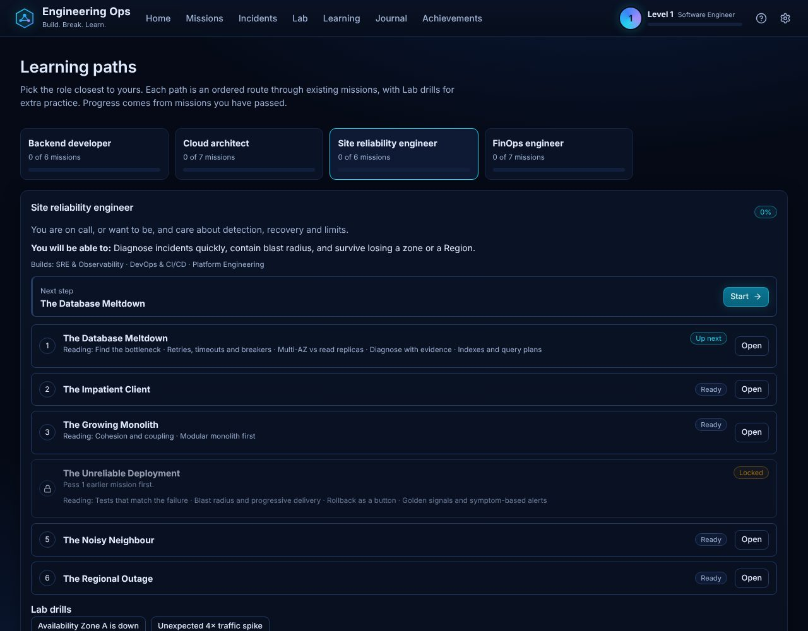

# Learning paths

Four ordered routes through the existing missions, one per role: **backend developer**, **cloud architect**,
**site reliability engineer** and **FinOps engineer**. Open them at `/paths`, or from the link on Mission Control and
the Academy.

## What a path is

- An ordered list of missions, chosen for the role and arranged so every prerequisite comes earlier in the list.
- A short statement of who it is for and what you can do after finishing it.
- The skill branches it builds most.
- Optional Lab drills (templates with a stated goal) for extra practice. Drill completion is not tracked.
- The lessons attached to each mission, shown as reading for that step.

Paths add no new missions or scoring. They are a view over what already exists.

## Progress

Progress comes only from missions you have **passed**. Each step is one of:

| State | Meaning |
| --- | --- |
| Done | passed |
| Up next | the first unfinished mission you can start now |
| Ready | unfinished and startable |
| Locked | a prerequisite mission has not been passed yet |

A failed attempt does not count as done.

## Adding or changing a path

Edit `src/content/paths.ts`. `src/game/paths.test.ts` fails if a mission, template or skill does not exist, if a
mission appears twice, or if a prerequisite is not listed before the mission that needs it.

